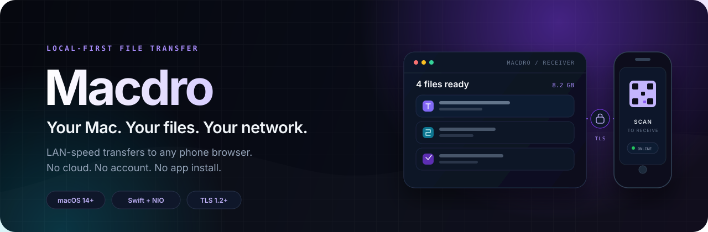
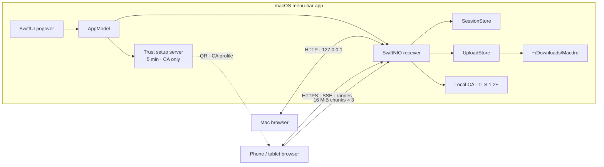

<div align="center">
  
</div>

<div align="center">

**A private, zero-install file portal for macOS.**

[](https://github.com/Goutham011/Macdro/releases/tag/v0.1.0)


[](#testing)


[Why Macdro](#why-macdro) · [Architecture](#architecture) · [Engineering](#engineering-highlights) · [Quick start](#quick-start) · [Testing](#testing) · [Roadmap](#status-and-roadmap)

</div>

> **Most file-transfer apps ask you to upload to someone else's cloud. Macdro doesn't.**
>
> It turns a Mac into a private, LAN-speed file portal for every browser on the network. Drag in files, scan a QR code, and transfer in either direction — including resumable uploads back to the Mac. No account, no cloud relay, no phone app.

## Why Macdro?

| Principle | What it means |
| :--- | :--- |
| **Private by construction** | The Mac-local receiver is loopback-only. Phone traffic uses LAN-only HTTPS with a locally generated CA. Files never leave your network. |
| **Zero-install client** | The receiver is an embedded web app served by the Mac. Any modern phone, tablet, or computer can use it — no App Store, no companion app, no sign-up. |
| **Built for real transfers** | Folders, ZIP64 downloads, HTTP ranges, SHA-256 manifests, resumable chunked uploads, quotas, and disk-space checks are designed in — not bolted on. |
| **Native where it matters** | A SwiftUI/AppKit menu-bar experience, SwiftNIO networking, CoreImage QR codes, and a security model that fits the local network. |

## What it does

- **Send both ways.** Download shared files from the Mac, or upload files and folder trees back to `~/Downloads/Macdro`.
- **Live receiver.** The browser updates over SSE, with a polling fallback when EventSource is unavailable.
- **Resumable uploads.** 16 MiB chunks, three parallel transfers, server-offset recovery, retry/backoff, and IndexedDB resume state across page reloads.
- **Folders, not just files.** Relative paths are preserved in both directions; “Download all” produces a streaming ZIP64 archive.
- **Connection-aware.** Detects Wi-Fi, Ethernet, iPhone USB tethering, and Android NCM tethering, then lets you choose the transport to share.
- **Trust that is visible.** A five-minute setup server serves an iPhone/iPad `.mobileconfig` or a CA certificate for Android/desktop, alongside a SHA-256 certificate fingerprint.
- **More than files.** Move plain text through the Mac clipboard from the browser.
- **Recovery states that make sense.** Session ended, connection lost, insufficient storage, rate limited, cancelled, and retryable failures all have explicit UI.

## Architecture



- **Loopback HTTP** serves the Mac-local receiver.
- **LAN HTTPS** serves phones and other computers through a locally trusted CA.
- **The setup server** is temporary, serves only trust material, and stops after five minutes.
- **One SwiftNIO handler** covers static assets, session JSON, SSE, ranges, ZIPs, clipboard, and uploads, with bounded buffers and backpressure.

## Engineering highlights

| Area | Implementation |
| :--- | :--- |
| **Non-blocking networking** | Dedicated SwiftNIO event loops for the receiver and a separate temporary trust server; `NIOThreadPool` for blocking file hashing and archive work. |
| **Backpressure under load** | Upload bodies are coalesced into 4 MiB writes, pending bytes are capped at 8 MiB, and channel reads pause/resume instead of growing memory without bound. TLS downloads and ZIPs stream in 256 KiB chunks with write-promise backpressure; loopback keeps `sendfile`. |
| **Resumable protocol** | Client upload IDs, explicit offsets, `409` responses with `X-Upload-Offset`, server-side leases, completed-upload tombstones, and atomic `.part` → final renames. |
| **Security engineering** | Loopback/LAN separation, private-address allowlist, constant-time session tokens, `HttpOnly`/`SameSite=Strict` cookies, CSP, path containment, symlink resolution, quotas, and rate limits. |
| **HTTP correctness** | Exact `Content-Length`, HEAD without bodies, ETag-based conditional requests, byte ranges, and consistent `304`/`206`/`416` behavior. |
| **TLS that a phone can trust** | OpenSSL-generated local CA and leaf certificates, `.mobileconfig` delivery, visible SHA-256 fingerprint, and TLS 1.2+ on the LAN listener. |
| **Product engineering** | Transport chooser, QR pairing, no-network recovery, upload cancellation/retry, live progress, and a browser UI that degrades when optional APIs are missing. |
| **Delivery discipline** | 80 XCTest cases, 71 self-test assertions, an audit harness, zero-warning verification, macOS CI, universal builds, and a tag-driven release workflow. |

### The upload path

```text
Browser
  └─ 16 MiB slice ─┐
  └─ 16 MiB slice ─┼─ 3 parallel XHRs ── HTTPS ──▶ SwiftNIO handler
  └─ 16 MiB slice ─┘                                  │
                                                      ├─ bounded pending buffer
                                                      ├─ 4 MiB coalesced writes
                                                      ├─ offset/lease validation
                                                      ├─ SHA-256 digest
                                                      └─ atomic rename
                                                            │
                                                            ▼
                                                   ~/Downloads/Macdro
```

On a dropped connection, the browser asks the server for the committed offset and resumes from there. A completed upload leaves a short-lived tombstone so a stale retry cannot overwrite a newer file.

## By the numbers

| Metric | Result |
| :--- | :--- |
| Automated tests | **80 passing** |
| Self-test assertions | **71 passing** |
| Compiler warnings | **0** |
| Universal release DMG | **8.1 MB** |
| Loopback download benchmark | **1.74 GB/s** |
| Upload benchmark with SHA-256 | **225 MB/s** |

Benchmarks were measured locally on the development Mac; they are illustrative, not guarantees.

## Quick start

### Use the app

1. Download the latest DMG from [GitHub Releases](https://github.com/Goutham011/Macdro/releases/latest).
2. Open the DMG and drag **Macdro** into **Applications**.
3. Launch Macdro. It appears in the menu bar — there is no Dock icon.
4. Put the Mac and phone on the same Wi-Fi, plug in Ethernet, or enable USB tethering.
5. Scan the QR code from the menu bar. If prompted, install the Macdro local CA and enable full trust on iOS.

> **First launch:** the current DMG is ad-hoc signed, so macOS may require **Control-click → Open** until Developer ID signing and notarization are added.

### Build from source

```bash
git clone https://github.com/Goutham011/Macdro.git
cd Macdro

brew install xcodegen
./scripts/verify.sh

CONFIG=debug ./scripts/build-app.sh
open dist/Macdro.app
```

For a universal release build:

```bash
./scripts/build-release.sh
# dist/Macdro.app
# dist/Macdro.dmg
# dist/Macdro.dmg.sha256
```

**Requirements:** macOS 14+, Xcode 16+ (built locally with Xcode 27.1), Swift 6.x toolchain, XcodeGen 2.46+. The release script produces `arm64` + `x86_64`.

## Stack

| Layer | Tools |
| :--- | :--- |
| **Host UI** | SwiftUI, AppKit, Combine, CoreImage |
| **Networking** | SwiftNIO, NIOHTTP1, NIOPosix, NIOSSL |
| **Security** | CryptoKit, local CA, `/usr/bin/openssl`, TLS 1.2+ |
| **System** | Network, SystemConfiguration, UniformTypeIdentifiers, zlib |
| **Web client** | Vanilla JavaScript, Fetch, SSE, XHR, IndexedDB, Clipboard API |
| **Build and delivery** | SwiftPM, XcodeGen, xcodebuild, GitHub Actions, hdiutil, codesign |
| **Verification** | XCTest, `MacdroSelfTest`, `MacdroAudit` |

No third-party frontend framework. No server-side database. No telemetry. No cloud.

## Testing

```bash
swift test                    # 80 XCTest cases
swift run MacdroSelfTest      # 71 end-to-end assertions
swift run MacdroAudit test    # raw HTTP / TLS / range / upload audit
./scripts/verify.sh           # clean build + all checks + Xcode build
```

Coverage includes TLS/listener separation, token and cookie behavior, resumable uploads, quotas, symlink and traversal defenses, slowloris bounds, range fuzz cases, SHA-256 manifests, TLS full/range/ZIP downloads, SSE heartbeats, and transport classification.

`verify.sh` treats compiler warnings as failures. CI runs the same gate on macOS 15 with Swift 6.1.

## Repository map

```text
Sources/Macdro/       Menu-bar app, SwiftUI views, connection state
Sources/MacdroKit/    SwiftNIO server, uploads, TLS, archives, web assets
Sources/MacdroSelfTest/  End-to-end self-test executable
Sources/MacdroAudit/     Raw HTTP/TLS audit harness
Tests/                80 XCTest cases
scripts/              App, universal DMG, and verification scripts
.github/workflows/    CI and tag-driven GitHub Releases
PROJECT_CONTEXT.md    Architecture, limits, invariants, and full file map
```

For the deeper design decisions, constraints, and build map, read [`PROJECT_CONTEXT.md`](PROJECT_CONTEXT.md).

## Status and roadmap

**Current: v0.1.0 — private beta.** Automated acceptance is green and the universal DMG is published through GitHub Releases.

- [x] Dual loopback HTTP / LAN HTTPS receiver
- [x] Zero-install browser client with live updates
- [x] Resumable, parallel uploads and ZIP64 transfers
- [x] Local CA trust flow for iPhone/iPad and Android
- [x] 80 tests, self-test, audit, zero-warning CI
- [x] Universal DMG release pipeline
- [ ] Physical iPhone hotspot and Android NCM validation
- [ ] Developer ID signing and notarization
- [ ] App icon, physical-device soak testing, optional Sparkle updates

Macdro is distributed as a direct DMG, not through the Mac App Store.

## Built by

<div align="center">

### [Goutham011](https://github.com/Goutham011)

If you are hiring for macOS, Swift, or systems-minded product engineering, I would be glad to walk through the architecture, trade-offs, and what comes next.

</div>

---

<sub>Private beta · Source access and a walkthrough are available on request · No open-source license has been granted yet.</sub>
